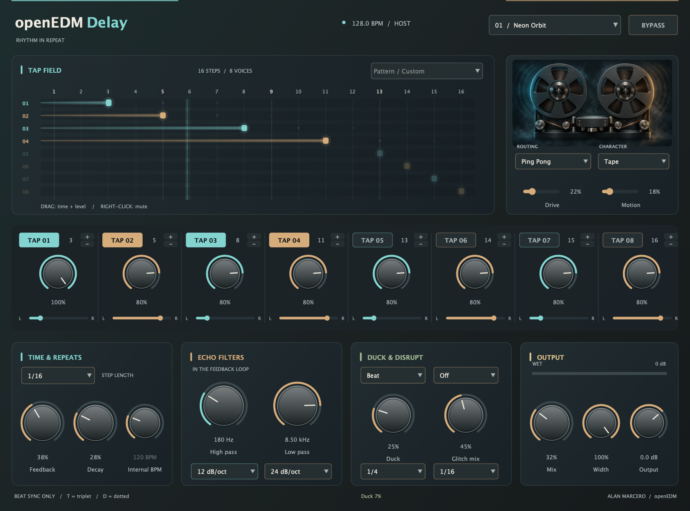
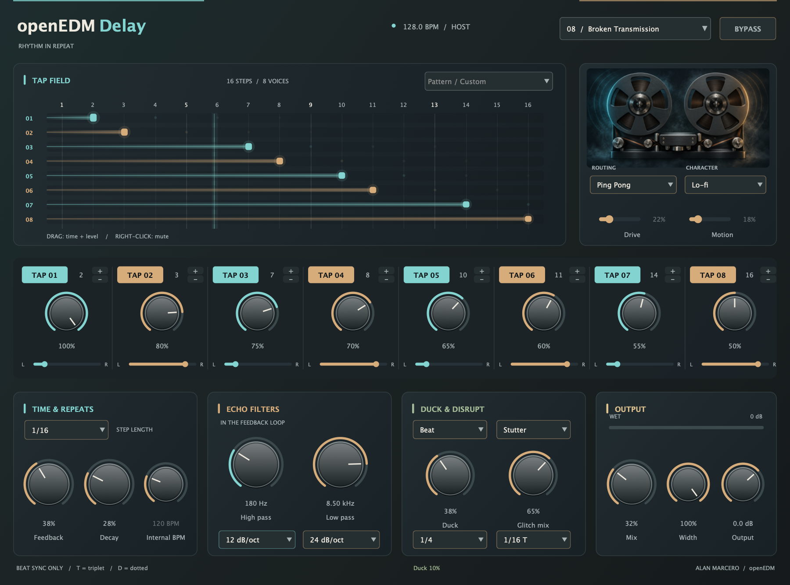

# openEDMDelay

An eight-tap, beat-synced delay for electronic music. Build rhythmic echoes, wide ping-pong patterns, worn tape trails and broken repeats with a native interface that fits the openEDM plugin family.



[Download](https://github.com/alanmarcero/openEDMDelay/releases/latest) · [OpenVST Manager](https://github.com/alanmarcero/alan-m-OpenVSTManager) · [Research notes](docs/research.md)

## Sound and timing

- Eight taps with individual enable, grid position, level and stereo pan. Drag the tap field horizontally to change time, vertically to change level, or right-click to mute.
- Stereo, Ping Pong and Mono routing. Ping Pong alternates tap sides and crossfeeds successive phrase repeats; Stereo uses each tap's pan.
- Digital, Tape, BBD and Lo-fi characters. Tape adds saturation, beat-related wow/flutter and pitch glide during timing changes. Other characters crossfade time changes over 25 ms.
- Twelve rhythm templates, including paired 1+1, 2+1, 3+2, 3+4 and 3+5 patterns, plus eight-tap sequences. Twelve factory programs are also exposed to the host.
- Straight, dotted and triplet grid lengths from 1/32 to 1/2 notes. Each tap can land on steps 1–16. There is no millisecond delay mode.
- Feedback repeats the entire phrase, using the last active tap as its length. Decay progressively reduces later tap levels. Tap levels are normalized to keep dense patterns manageable.
- High-pass and low-pass filters in the feedback loop, each with Off, 6, 12, 24 or 48 dB/oct slopes. Echoes pass through the filters again on each phrase repeat.
- Wet-only ducking from the beat or the input envelope. The Duck rate controls beat repetition or input-follower recovery.
- Wet-only Gate, Stutter and Reverse effects with their own beat rate and mix. Stutter and Reverse replay the preceding slice and need history to fill before producing sound.
- Mix, stereo width, output gain, bypass, host automation and session recall. Mono and stereo buses; zero added dry-path latency.

The host supplies BPM whenever it provides a valid tempo between 20 and 400. Without it, the clearly labeled Internal clock uses the Internal BPM control (120 by default). Beat effects follow host PPQ while playing and continue from an internal phase while stopped. The Standalone application uses the internal clock.

Drive applies to Tape and BBD; Motion applies to Tape. Tap pan applies to Stereo. Inactive controls are disabled. Double-click a knob to restore its default; click its value to type a setting. Use 100% Mix on an auxiliary return.



Both screenshots are captures of the compiled JUCE editor, taken by the integration test with a simulated 128 BPM host. The tape illustration is original generated artwork embedded in that editor.

## Install

OpenVST Manager discovers this plugin through its public catalog and installs the VST3 and available AU from the release ZIPs. You can also download and install manually:

| Platform | Formats | Plugin folder |
| --- | --- | --- |
| macOS (Apple Silicon + Intel) | VST3, AU, Standalone | `~/Library/Audio/Plug-Ins/VST3` and `~/Library/Audio/Plug-Ins/Components` |
| Windows x64 | VST3, Standalone | Your DAW's VST3 folder, typically `C:\Program Files\Common Files\VST3` |
| Linux x64 | VST3, Standalone | `~/.vst3` |

Rescan plugins in your DAW after installing. macOS binaries are ad hoc signed and not notarized. Release checksums are provided in `SHA256SUMS.txt`.

## Build and verify

Requires CMake 3.22+, a C++20 compiler and platform audio/GUI development libraries. CMake downloads JUCE 8.0.9. On macOS use Xcode; on Windows use Visual Studio 2022 or later. Linux package dependencies are listed in [the build workflow](.github/workflows/build.yml).

```sh
cmake -S . -B build -DCMAKE_BUILD_TYPE=Release
cmake --build build --config Release --parallel 4
ctest --test-dir build -C Release --output-on-failure
```

Artifacts are in `build/openEDMDelay_artefacts/Release/`. For a universal macOS build, add `-DCMAKE_OSX_ARCHITECTURES="arm64;x86_64" -DCMAKE_OSX_DEPLOYMENT_TARGET=11.0` when configuring. Linux integration tests need a desktop session or `xvfb-run -a ctest --test-dir build --output-on-failure`.

The DSP-only tests need no JUCE or display:

```sh
cmake -S . -B build-core -DOED_BUILD_PLUGIN=OFF -DCMAKE_BUILD_TYPE=Debug
cmake --build build-core --parallel 4
ctest --test-dir build-core --output-on-failure
```

To capture the native editor after building, run `build/openedmdelay_plugin_tests docs/screenshots` (use `build/Release/openedmdelay_plugin_tests.exe` on Windows).

CI builds all three platforms, runs DSP and native integration tests, validates macOS/Windows VST3 with pluginval at strictness 5, and runs Linux address/undefined sanitizers. A `v*` tag publishes packages only after every job passes.

## Design notes

The core preallocates enough history for a 32-beat phrase at 20 BPM: approximately 42 MB at 48 kHz, scaling with sample rate. It allocates no buffers while processing. Continuous level controls are smoothed. Reset and bypass invalidate history so old echoes do not return. Feedback storage is bounded; the output gain can still produce peaks above 0 dBFS.

These are original algorithms inspired by the documented workflows of Vengeance Essential FX Delay, Waves SuperTap/H-Delay and Access Virus. They are not bit-accurate hardware emulations or compatible with Virus presets. [Research notes](docs/research.md) link the primary sources and explain the differences. The current version uses the main input for input ducking; it has no external sidechain bus.

Source: AGPL-3.0. See [LICENSE](LICENSE) and [third-party notices](THIRD_PARTY.md).
