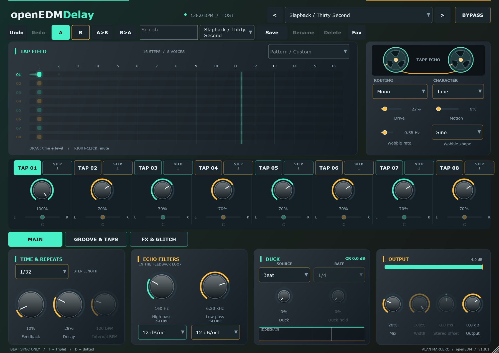
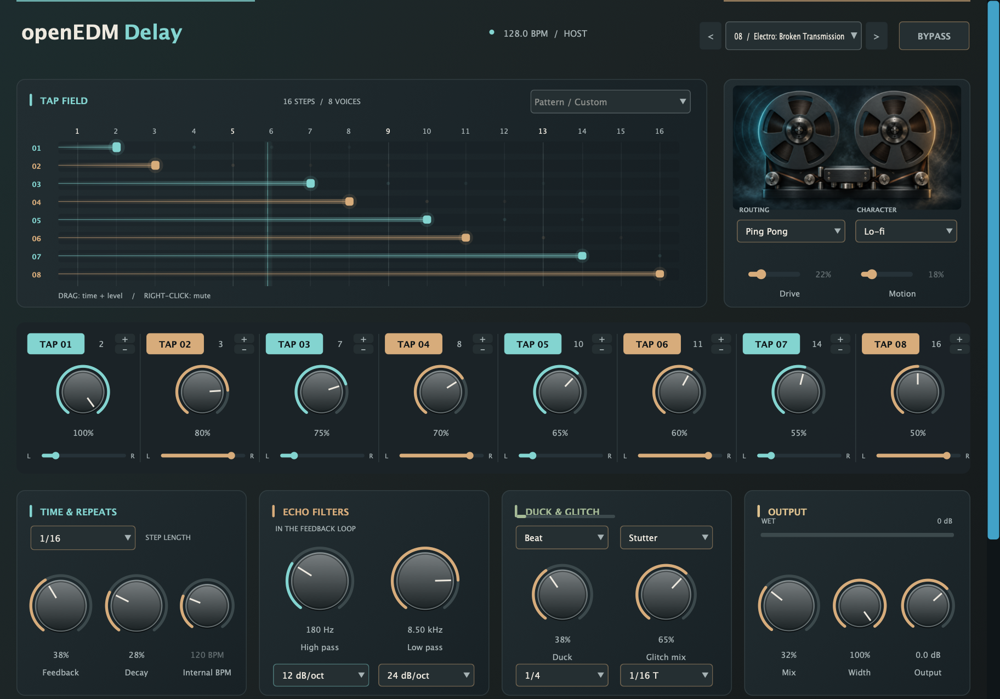

# openEDMDelay v1.6.0

Build beat-synced echoes from eight taps. Use it for rhythmic repeats, stereo movement, and reversed echoes.

[Download the latest release](https://github.com/alanmarcero/openEDMDelay/releases/latest) · [OpenVST Manager](https://github.com/alanmarcero/alan-m-OpenVSTManager/releases/latest)

## Choose an echo

The 72 factory programs are grouped by the kind of delay, not by genre. Every program follows the host tempo, including the short slapbacks (1/32 and 1/16) and the long ambient tails.

- **Slapback** — one short repeat
- **Quarter** — straight 1/4-note echoes
- **Dotted** — dotted 1/8 and dotted 1/4
- **Triplet** — triplet grid
- **Ping-Pong** — each repeat bounces left, then right
- **Tape Dub** — dark, saturated, wobbling feedback
- **Filtered** — the repeats are shaped by the feedback filters
- **Ducked** — echoes sit under the dry hit, then bloom in the gap
- **Multi-Tap** — a rhythmic pattern of taps
- **Ambient** — diffused, long, washy tails
- **Reverse** — the echoes play backwards
- **Piano** — slap, 1/4, dotted 1/8, and reverse for house and trance chords and stabs

Start with **Ping-Pong / Dotted Eighth** on a pluck, **Tape Dub / Quarter** on a chord, or **Piano / Quarter Stab** on a stab. The preset arrows step through the whole bank. The 12 rhythm templates in **Tap field** change tap positions, levels, and pans while keeping your grid and effects. Older sessions recall their saved settings and display **Custom sound**.

## Features

- **Eight taps:** Enable each tap, set its grid position and level, and place it in the stereo field. Drag the tap display to change time, level, or pan. Right-click a tap to mute it.
- **Beat grid:** Choose straight, dotted, or triplet divisions from 1/32 to a dotted whole note. Each tap can use 1–16 steps, for phrases up to 96 beats.
- **Stereo and character:** Choose Stereo, Ping Pong, or Mono routing. Ping Pong crossfeeds each repeat so a single delay bounces left and right. Stereo follows each tap's pan. Choose Digital, Tape, BBD, or Lo-fi for the feedback sound. Tape and BBD warm the repeats with saturation and a gentle rolloff. Tape Motion sets wobble depth. Wobble Rate ranges from 0.05 to 8 Hz with five waveforms. Square and random shapes are smoothed so they do not click.
- **Reverse:** Set Reverse to play each echo backwards. Reverse length is a tempo division (1/8, 1/4, 1/2, a bar). Two overlapped fades hide the splice. Feedback and Ping Pong keep working. This is separate from the Glitch Reverse chop on the wet signal.
- **Per-tap shaping:** Set Chance from 0–100% and add 1–8 ratchets to each tap. Add optional 12 dB per octave high-pass or low-pass filters, color, and drive.
- **Groove controls:** Adjust Swing or choose Manual, Shuffle, or Broken groove. Pattern Morph moves taps toward their editable target steps.
- **Feedback and diffusion:** Feedback repeats the phrase. Decay reduces later repeats. High-pass and low-pass feedback filters offer Off, 6, 12, 24, or 48 dB per octave. Diffusion softens repeats with Amount and Size controls from 2 to 30 ms.
- **Hold and beat effects:** Hold recirculates the current phrase without new input. Duck the wet signal from the beat or input level. Duck Rate controls beat repetition or follower recovery.
- **Wet effects:** Add Gate, Stutter, or Reverse effects with their own beat rate and mix.
- **Output:** Set dry/wet Mix, stereo Width, and output gain. Use bypass. Controls support host automation and session recall. The dry path adds no latency.

Delay grids and beat effects follow host tempo from 20 to 400 BPM when available. The internal clock uses 120 BPM by default. The animated tape reels turn once every two beats, follow host seeks, and hold their position when transport stops. Standalone and hosts without a playhead use the internal clock. The audio beat effects continue on their internal clock when the host stops. Input ducking listens to the main input. There is no separate sidechain bus.

## Install and compatibility

Install the VST3 or AU with [OpenVST Manager](https://github.com/alanmarcero/alan-m-OpenVSTManager/releases/latest). Download the standalone app or manual packages from the [latest release](https://github.com/alanmarcero/openEDMDelay/releases/latest).

| Platform | Formats |
| --- | --- |
| macOS, Apple Silicon or Intel | VST3, AU, Standalone |
| Windows, x64 | VST3, Standalone |
| Linux, x64 | VST3, Standalone |

The plugin supports mono and stereo audio. Rescan your DAW after installing. Set Mix to 100% when you use the delay on an auxiliary return.

## License

openEDMDelay uses the AGPL-3.0 license. See [LICENSE](LICENSE) and [third-party notices](THIRD_PARTY.md).
